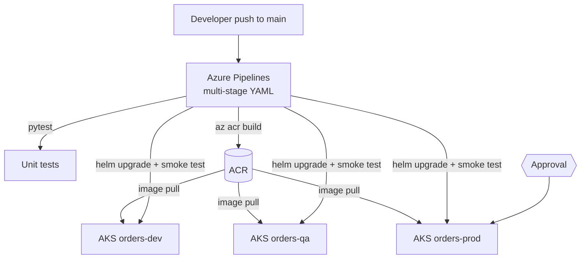

# AKS Delivery Platform with Azure DevOps

A reusable, multi-stage Azure Pipelines setup that tests a containerized API, builds the image in Azure Container Registry (ACR), and promotes the same image through Dev, QA and Production on Azure Kubernetes Service (AKS) with Helm. Production is gated by an environment approval, and every deployment runs a smoke test that rolls the release back automatically if it fails.

> Portfolio lab. The application, data and defect are synthetic. No employer code or client details are included.

| | |
|---|---|
| **Stack** | Azure Pipelines (multi-stage YAML, templates), ACR, AKS, Helm, Python/Flask, pytest |
| **Demo** | A release with a simulated defect fails its smoke test and is rolled back to the previous version |
| **Runs locally** | Yes: unit tests and the full release, failure and rollback flow |
| **Needs Azure for** | ACR build, AKS deployment, environment approvals |

## Architecture



The deployment and rollback sequence diagram is in [docs/architecture.md](docs/architecture.md).

## Repository layout

```
app/                     Flask Orders API, Dockerfile, requirements
helm/orders-api/         Helm chart (Deployment, Service, Ingress, HPA, PDB)
helm/orders-api/env/     values-dev.yaml, values-qa.yaml, values-prod.yaml
pipelines/               azure-pipelines.yml + reusable templates/
scripts/smoke_test.py    post-deploy checks used by the pipeline and the demo
scripts/deploy_with_rollback.sh   helm upgrade -> smoke test -> helm rollback
scripts/local_release_demo.py     local version of the same flow
scripts/azure-bootstrap.sh / azure-cleanup.sh
tests/                   pytest suite
docs/                    architecture, approvals, issues, demo script
```

## Run it locally (no Azure)

Requirements: Python 3.10+.

```bash
cd projects/01-aks-delivery-platform
python -m venv .venv && source .venv/bin/activate
pip install -r app/requirements.txt pytest

python -m pytest tests            # 7 tests
python scripts/local_release_demo.py
```

Expected end of the demo output:

```
  REVISION TAG     STATUS      DESCRIPTION
  1        1.0.0   superseded  Upgrade complete
  2        1.1.0   superseded  Upgrade complete
  3        1.0.0   deployed    Rollback to 1

DEMO RESULT: PASS - bad release was rolled back to 1.0.0
```

Run the API on its own with `APP_VERSION=1.0.0 python app/app.py`, then open `http://localhost:8080/api/v1/orders`. Add `RELEASE_DEFECT=true` to see the simulated defect.

With Docker:

```bash
docker build -t orders-api:1.0.0 app
docker run --rm -p 8080:8080 -e APP_VERSION=1.0.0 orders-api:1.0.0
python scripts/smoke_test.py --base-url http://localhost:8080 --expected-version 1.0.0
```

## Deploy on Azure

**Prerequisites:** an Azure subscription, Azure CLI 2.60+, an Azure DevOps project, and permission to create service connections.

**Billable resources:** AKS (2 × Standard_B2s nodes) and ACR Basic. Delete them when you finish.

1. Create the resources:
   ```bash
   bash scripts/azure-bootstrap.sh      # prints acrName, aksResourceGroup, aksClusterName
   ```
2. In Azure DevOps, create the `sc-aks-delivery` service connection, the `aks-delivery` variable group and the three environments with approvals. See [docs/approvals.md](docs/approvals.md).
3. Create a pipeline from `projects/01-aks-delivery-platform/pipelines/azure-pipelines.yml` and run it on `main`.
4. Approve the Production stage when prompted.

**Try the rollback on AKS:** queue a run with the defect switched on for one environment, for example by adding `--set releaseDefect=true` to the `deploy_with_rollback.sh` call in `templates/deploy-aks.yml` for a test branch. The stage logs show the failed smoke test, `helm rollback`, and the restored version passing.

```bash
helm history orders-api -n orders-dev
kubectl -n orders-dev get deploy orders-api -o jsonpath='{.spec.template.spec.containers[0].image}'
```

## Troubleshooting

| Symptom | Check | Fix |
|---|---|---|
| Pods in `ImagePullBackOff` | `az aks check-acr -g <rg> -n <aks> --acr <acr>.azurecr.io` | `az aks update -g <rg> -n <aks> --attach-acr <acr>` |
| `helm upgrade` times out | `kubectl -n <ns> describe pod` and `kubectl -n <ns> logs deploy/orders-api` | Check probe paths and resource limits in `values.yaml` |
| Smoke test cannot connect | `/tmp/port-forward.log` on the agent | Confirm the Service name matches the Helm release name |
| Stage waits forever | Environment → Approvals and checks | Approve, or check the approval timeout |
| `Could not find service connection` | Service connection name and pipeline permissions | Name must be `sc-aks-delivery`, or change the `azureServiceConnection` variable |

## Cleanup

```bash
bash scripts/azure-cleanup.sh        # deletes rg-aks-delivery-lab
```

Locally there is nothing to clean up; the demo stops its own processes.

## Issues and demo

- Backlog with acceptance criteria: [docs/issues.md](docs/issues.md)
- Demo recording script and captions: [docs/demo.md](docs/demo.md)
