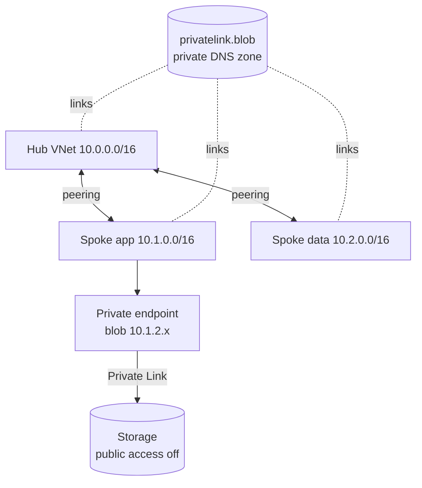

# Azure Hub-and-Spoke Infrastructure with Terraform

Reusable Terraform modules for a hub-and-spoke network on Azure: hub and spoke VNets, two-way peering, NSGs, a private endpoint for a storage account, and private DNS zone links. State is kept in Azure Storage with Entra ID authentication. The lab includes a reproducible private DNS misconfiguration, a tool that explains the resolution path, and the Terraform fix.

> Portfolio lab with synthetic names and address ranges. No employer configuration is included.

| | |
|---|---|
| **Stack** | Terraform 1.7+, azurerm 4.x, Azure VNets, NSGs, Private Endpoint, Private DNS, Azure Storage |
| **Demo** | The app spoke resolves storage to a public IP (403). Linking the zone restores private resolution |
| **Runs locally** | Yes: static checks, the DNS resolution model and the incident walkthrough. `terraform validate`/`test` with Terraform installed |
| **Needs Azure for** | `terraform apply`, remote state, `nslookup` from a VM in the spoke |

## Architecture



More detail, including the broken and fixed resolution sequence: [docs/architecture.md](docs/architecture.md).

## Layout

```
modules/hub-network      VNet + shared subnets
modules/spoke-network    VNet + workload and private-endpoint subnets
modules/vnet-peering     hub<->spoke peering, both directions
modules/nsg              NSG with rule map + subnet associations
modules/private-dns      zone + VNet links
modules/private-endpoint endpoint + DNS zone group
envs/lab                 composition, backend, tests/*.tftest.hcl, misconfig.tfvars
bootstrap/               remote-state.sh, cleanup.sh
tools/                   dns_check.py, dns_incident_demo.py, validate_tf.py, verify-on-azure.sh
scenarios/               broken.json / fixed.json (same shape as the dns_model output)
```

## Run locally

```bash
cd projects/02-azure-hub-spoke-terraform
pip install pytest
python -m pytest tests                 # 7 tests
python tools/validate_tf.py            # static checks
python tools/dns_incident_demo.py      # broken -> diagnose -> fixed
```

With Terraform 1.7+ installed (no Azure login needed):

```bash
cd envs/lab
terraform fmt -check -recursive ../..
terraform init -backend=false
terraform validate
terraform test                         # 3 runs with a mocked azurerm provider
```

## Deploy on Azure

**Prerequisites:** Azure CLI logged in (`az login`), Terraform 1.7+, Contributor and User Access Administrator (for the state role assignment) on a subscription.

**Billable resources:** VNets and peering (peering traffic is charged per GB), one private endpoint (hourly), a private DNS zone, two storage accounts. The optional test VM in `verify-on-azure.sh` is deleted by the script.

```bash
export ARM_SUBSCRIPTION_ID=$(az account show --query id -o tsv)
bash bootstrap/remote-state.sh                   # writes envs/lab/backend.hcl
cd envs/lab
terraform init -backend-config=backend.hcl
terraform plan -out tfplan && terraform apply tfplan
```

### Reproduce and fix the DNS incident

```bash
terraform apply -var-file=misconfig.tfvars      # removes the app spoke link
terraform output -json dns_model > /tmp/model.json
python ../../tools/dns_check.py --model /tmp/model.json --from-vnet app \
  --name "$(terraform output -raw storage_blob_fqdn)" --expect private   # FAIL
bash ../../tools/verify-on-azure.sh             # nslookup shows a public address

terraform apply                                 # restores the link
bash ../../tools/verify-on-azure.sh             # Address: 10.1.2.x
```

## Troubleshooting

| Symptom | Likely cause | Check |
|---|---|---|
| 403 `AuthorizationFailure` from storage inside a spoke | Zone not linked to that VNet | `az network private-dns link vnet list -g <rg> -z privatelink.blob.core.windows.net -o table` |
| `nslookup` returns NXDOMAIN for the privatelink name | Private endpoint has no DNS zone group | `az network private-endpoint dns-zone-group list -g <rg> --endpoint-name pe-hslab-blob` |
| Peering shows `Initiated` | Only one direction exists | `az network vnet peering list -g <rg> --vnet-name vnet-hslab-hub -o table` |
| `terraform init` 403 on state | Missing Storage Blob Data Contributor | Re-run the role assignment in `bootstrap/remote-state.sh` |
| Plan fails with "address_space must be a valid CIDR" | Typo in tfvars | Fix the CIDR; validation is intentional |

## Cleanup

```bash
bash bootstrap/cleanup.sh      # terraform destroy + delete rg-tfstate-lab
```

## Issues and demo

- Backlog: [docs/issues.md](docs/issues.md)
- Demo script: [docs/demo.md](docs/demo.md)
