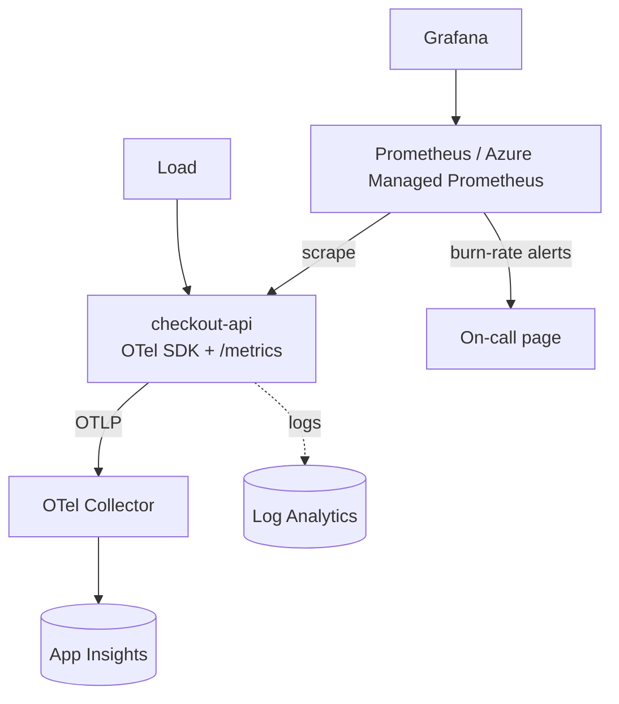

# AKS Observability and SRE Incident Lab

A checkout service instrumented with OpenTelemetry traces and Prometheus metrics, with latency and availability SLOs, error budgets and multi-window burn-rate alerts. The lab simulates a latency incident and walks through detection, diagnosis, mitigation, recovery and a blameless postmortem. It also shows how the same setup runs on AKS with Azure Monitor managed Prometheus, Azure Managed Grafana and Log Analytics.

> Portfolio lab. The service, traffic and incident are synthetic. Times and numbers in the postmortem come from the simulator.

| | |
|---|---|
| **Stack** | OpenTelemetry, Prometheus, PromQL recording/alert rules, Grafana, OTel Collector, AKS, Azure Monitor, Log Analytics |
| **SLO** | 99% of `POST /api/checkout` within 300 ms over 30 days (error budget 1%) |
| **Demo** | Inventory dependency slows down: alert fires, span timings show the cause, cache fallback restores the SLO |
| **Runs locally** | Yes: service, metrics, live incident demo, 3-hour simulation, tests. Full Prometheus/Grafana stack with Docker Compose |
| **Needs Azure for** | Managed Prometheus, Managed Grafana, Container Insights, Application Insights |

## Architecture



Full diagrams: [docs/architecture.md](docs/architecture.md).

## Run locally

```bash
cd projects/03-aks-observability-sre-lab
pip install flask opentelemetry-api pyyaml pytest
python -m pytest tests                  # 8 tests, includes the live demo (~20 s)
python sim/live_incident_demo.py        # real service, compressed windows
python sim/incident_sim.py              # minute-by-minute 3-hour timeline
```

Expected end of the live demo:

```
  baseline 0.0x -> incident 53.6x -> after mitigation 0.0x
DEMO RESULT: PASS - detected, diagnosed, mitigated and recovered
```

(The incident burn rate varies slightly between runs.)

### Full stack with Docker Compose

```bash
docker compose up -d --build
# Grafana  http://localhost:3000  -> SRE / checkout-api SLO
# Prometheus http://localhost:9090/alerts
curl -X POST localhost:8080/admin/fault -H 'Content-Type: application/json' -d '{"latency_ms":800,"ratio":0.6}'
# wait for the burn-rate panel to rise, then mitigate:
curl -X POST localhost:8080/admin/fallback -H 'Content-Type: application/json' -d '{"enabled":true}'
docker compose down
```

With real Prometheus windows (1h + 5m), the page fires about 15–17 minutes into the fault, matching the simulator.

### Rule unit tests

```bash
promtool check rules prometheus/rules/slo-rules.yaml
promtool test rules prometheus/tests/slo-rules.test.yaml
```

## Run on AKS with Azure Monitor

See [docs/azure-monitor.md](docs/azure-monitor.md) for the commands to enable managed Prometheus, Managed Grafana and Container Insights, apply the PodMonitor, load the rule groups and query logs with KQL.

**Billable resources:** AKS, Azure Monitor workspace, Azure Managed Grafana, Log Analytics workspace, Application Insights.

## SRE documents

- [Runbook](docs/runbook.md) for the burn-rate alerts
- [Postmortem](docs/postmortem.md) for the simulated incident
- [Incident timeline data](docs/incident-timeline.json)

## Troubleshooting

| Symptom | Check |
|---|---|
| Burn-rate panel empty | Prometheus targets page: is `checkout-api` UP? Recording rules need 5 minutes of data |
| Alert never fires in Compose | Fast burn needs the 1h window above 14.4%; keep the fault on for 20 minutes |
| No traces in the collector | `OTEL_EXPORTER_OTLP_ENDPOINT` set? `docker compose logs otel-collector` |
| PodMonitor ignored on AKS | `kubectl get pods -n kube-system -l rsName=ama-metrics`; API group must be `azmonitoring.coreos.com` |

## Cleanup

`docker compose down -v` locally. On Azure, delete the resource group used for the cluster and monitoring resources.

## Issues and demo

- Backlog: [docs/issues.md](docs/issues.md)
- Demo script: [docs/demo.md](docs/demo.md)
