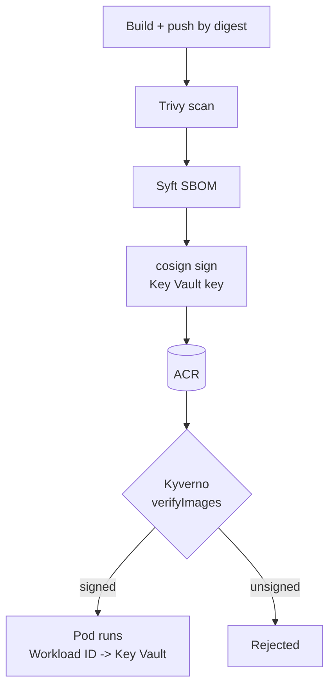

# Azure DevSecOps Software Supply Chain

An Azure Pipelines workflow that scans code and images with Trivy, generates an SBOM with Syft, signs the image with Cosign using a key held in Azure Key Vault, and verifies the signature before deployment. On AKS, a Kyverno policy rejects any unsigned image, and the workload reads its secret from Key Vault through Microsoft Entra Workload ID and the Secrets Store CSI driver.

> Portfolio lab. Images, keys and secrets are synthetic and harmless. The local demo uses real ECDSA signatures in Cosign's payload format; the pipeline uses the real Cosign CLI.

| | |
|---|---|
| **Stack** | Azure Pipelines, ACR, Trivy, Syft (SPDX), Cosign + Azure Key Vault KMS, Kyverno, AKS, Entra Workload ID, Secrets Store CSI driver |
| **Demo** | An unsigned test image is rejected at admission; the signed image is admitted |
| **Runs locally** | Yes: signing, verification and the admission webhook decisions |
| **Needs Azure for** | ACR, Key Vault key, pipeline run, Kyverno on AKS, Workload ID |

## Architecture



Full diagrams: [docs/architecture.md](docs/architecture.md).

## Run locally

```bash
cd projects/04-azure-devsecops-supply-chain
pip install flask cryptography pyyaml pytest
python -m pytest tests          # 9 tests
python admission/demo.py
```

Expected output:

```
  unsigned-pod     -> REJECTED: ...demo-app@sha256:...: no signature found - image is unsigned
  signed-pod       -> ADMITTED: signature verified for all protected images
  tag-only-pod     -> REJECTED: ...: protected images must be referenced by digest (@sha256:...)
  tampered-pod     -> REJECTED: ...: signature was made for a different digest
  unprotected-pod  -> ADMITTED: no images from protected registries

DEMO RESULT: PASS - unsigned image rejected, signed image admitted
```

## Run on Azure

**Prerequisites:** AKS cluster attached to an ACR, Azure CLI, Helm, an Azure DevOps project with a workload-identity-federation service connection `sc-supplychain`.

**Billable resources:** ACR, AKS, Key Vault (key operations), pipeline minutes.

1. Identity, Key Vault, secret and signing key:
   ```bash
   bash workload-identity/setup.sh
   ```
   Give the pipeline's service principal `Key Vault Crypto User` on the vault so it can sign.
2. Install Kyverno and the policies:
   ```bash
   helm repo add kyverno https://kyverno.github.io/kyverno/ && helm install kyverno kyverno/kyverno -n kyverno --create-namespace
   cosign public-key --key azurekms://<vault>.vault.azure.net/cosign-signing > cosign.pub
   # paste cosign.pub into policy/kyverno/verify-image-signatures.yaml
   kubectl apply -f policy/kyverno/
   ```
3. Apply `workload-identity/k8s/namespace-sa.yaml` and `secretproviderclass.yaml` with your values, then run `pipelines/azure-pipelines.yml`.
4. Prove the policy:
   ```bash
   docker pull busybox:1.36 && docker tag busybox:1.36 <acr>.azurecr.io/supplychain/demo-app:unsigned-test
   docker push <acr>.azurecr.io/supplychain/demo-app:unsigned-test
   kubectl apply -f policy/test-pods.yaml
   # Error from server: admission webhook "mutate.kyverno.svc-fail" denied the request: ... unsigned-test ...
   ```

## Troubleshooting

| Symptom | Check / fix |
|---|---|
| `cosign sign` 403 from Key Vault | Pipeline identity needs `Key Vault Crypto User`; `AZURE_*` variables exported in the step |
| Signed pod rejected `UNAUTHORIZED` | Kyverno cannot read ACR; see ISSUE-4 in [docs/issues.md](docs/issues.md) |
| Trivy fails on a CVE without a fix | `--ignore-unfixed` is set; for accepted risk add the CVE to `.trivyignore` with a reason |
| Secret volume `MountVolume.SetUp failed` | Pod label `azure.workload.identity/use: "true"`, SA annotation client ID, federated credential subject |

## Cleanup

```bash
kubectl delete namespace supplychain
helm uninstall kyverno -n kyverno
az keyvault delete -n <vault> && az keyvault purge -n <vault>
az identity delete -g rg-supplychain-lab -n id-demo-app
```

## Issues and demo

- Backlog: [docs/issues.md](docs/issues.md)
- Demo script: [docs/demo.md](docs/demo.md)
