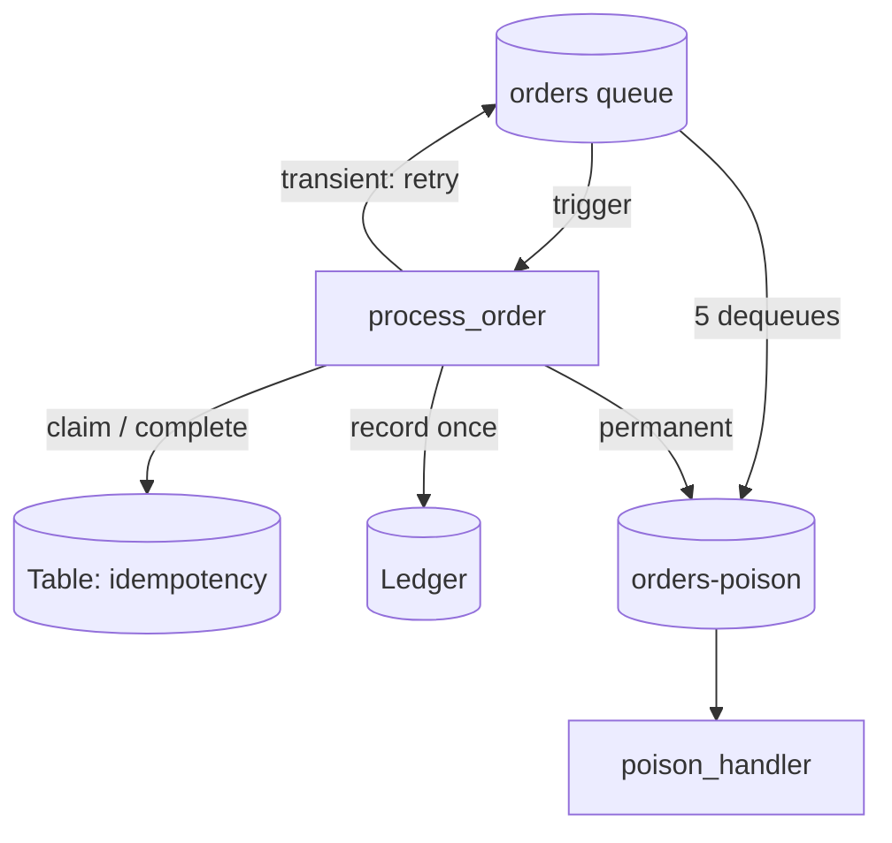

# Azure Functions Event-Driven Processing

A queue-triggered Azure Function (Python v2 programming model) that processes order events with idempotency, retry classification, poison-message handling and structured logging. A local runtime reproduces Storage Queue behaviour, including duplicate delivery, so every scenario can be tested without Azure.

> Portfolio lab with synthetic order events.

| | |
|---|---|
| **Stack** | Azure Functions (Python), Storage Queues, Table Storage, Application Insights, Azurite |
| **Demo** | The same event is delivered three times and recorded once |
| **Runs locally** | Yes: processor, local queue runtime, tests. `func start` with Azurite for the real host |
| **Needs Azure for** | Function App, storage account, Application Insights |

## Architecture



## Run locally (no Azure)

```bash
cd projects/05-azure-functions-event-processing
pip install pytest
python -m pytest tests              # 19 tests
python src/local_runtime.py         # add --verbose for JSON logs
```

Expected result:

```
  ledger entries: [('ORD-1', 499.0, 'INR'), ('ORD-2', 1250.0, 'INR')]
  poison queue:   [(..., 'missing fields: eventId, amount, currency'), (..., 'ledger service returned 503')]
DEMO RESULT: PASS - ORD-1 processed exactly once despite 3 deliveries
```

### With the Functions host and Azurite

Requires Azure Functions Core Tools v4, Azurite and Azure CLI.

```bash
azurite --silent &                                   # or: docker run -p 10000-10002:10000-10002 mcr.microsoft.com/azure-storage/azurite
cd src && cp local.settings.json.example local.settings.json
pip install -r requirements.txt && func start
# second terminal
bash scripts/send-test-messages.sh
```

The host log shows `order processed`, `duplicate ignored` and the malformed message moving to `orders-poison`.

## Deploy on Azure

**Billable resources:** Function App (Flex Consumption), storage account (queues, tables), Application Insights.

```bash
bash scripts/azure-deploy.sh
```

KQL in Application Insights:

```kusto
traces
| where message startswith "{"
| extend e = parse_json(message)
| summarize count() by tostring(e.outcome), bin(timestamp, 1m)
```

## Troubleshooting

| Symptom | Check / fix |
|---|---|
| Every message goes to poison on the first try | Producer must base64-encode, or set `"messageEncoding": "none"` in `host.json` |
| Duplicates still processed | Is the Table store shared by all instances? Same `AzureWebJobsStorage`? |
| Retries happen too fast | Increase `visibilityTimeout` in `host.json` |
| Function never triggers locally | Azurite running? `AzureWebJobsStorage=UseDevelopmentStorage=true`? |

## Cleanup

```bash
az group delete -n rg-func-orders-lab --yes --no-wait
```

## Issues and demo

- Backlog: [docs/issues.md](docs/issues.md)
- Demo script: [docs/demo.md](docs/demo.md)
