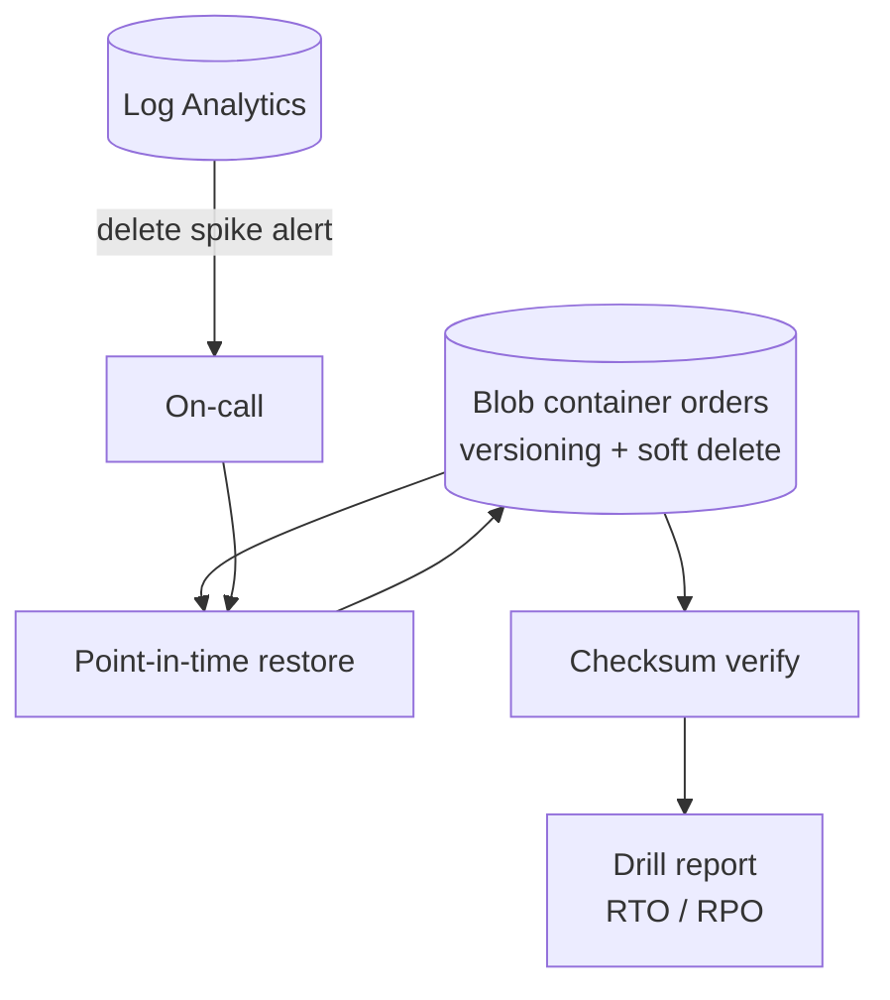

# Azure Disaster Recovery and Restore Drill

A repeatable backup-and-restore drill for a synthetic orders archive. It deletes the data on purpose, restores the latest backup, proves integrity with SHA-256 checksums and record counts, and writes a report with measured RTO and RPO against targets. The Azure version uses Blob Storage point-in-time restore.

> Portfolio lab. All data is generated and synthetic.

| | |
|---|---|
| **Stack** | Azure Blob Storage (versioning, change feed, soft delete, PITR), Azure CLI, Log Analytics, Python |
| **Targets** | RTO 30 min, RPO 60 min |
| **Demo** | 1,037 records, primary deleted, 1,000 restored and verified; 37 records written after the backup are the measured RPO loss |
| **Runs locally** | Yes: full drill and tests |
| **Needs Azure for** | `scripts/azure-drill.sh` (PITR) |

## Architecture



## Run locally

```bash
cd projects/06-azure-dr-restore-drill
pip install pytest
python -m pytest tests     # 4 tests
python dr/drill.py         # writes docs/drill-report.md
```

Expected:

```
  checksum verification: PASS (20 files)
  records restored: 1000 of 1037 (lost: 37)
  RTO 7.0 min (target 30) -> MET
  RPO 45 min / 37 records (target 60 min) -> MET
DEMO RESULT: PASS - data restored, checksums verified, RTO and RPO met
```

## Run on Azure

**Prerequisites:** Azure CLI logged in, permission to create a storage account and a role assignment.
**Billable:** one Standard_LRS storage account (versions and soft-deleted data count towards capacity).

```bash
bash scripts/azure-drill.sh
```

The script enables PITR, uploads the dataset, records a restore point, deletes every blob, restores, downloads and runs `verify_dir.py`. It prints `INTEGRITY PASS` and the measured restore time.

## Troubleshooting

| Symptom | Check / fix |
|---|---|
| `restore policy is not enabled` | Versioning, change feed and delete retention must all be on; retention days > restore days |
| Restore point rejected | It must be within the restore window and after the policy was enabled |
| `AuthorizationPermissionMismatch` | Assign `Storage Blob Data Contributor` and wait for propagation |
| `INTEGRITY FAIL: missing ...` | Restore point earlier than the upload; pick a later time |

## Cleanup

```bash
az group delete -n rg-dr-drill-lab --yes --no-wait
```

## Docs

- [Runbook](docs/runbook.md) · [Latest drill report](docs/drill-report.md) · [Issues](docs/issues.md) · [Demo script](docs/demo.md)
